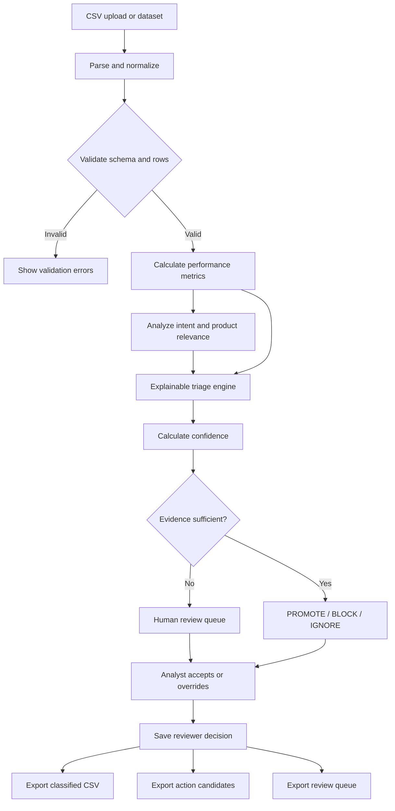

# SearchIQ — Intelligent Search Term Triage Engine

> **PS-01 Srishti-2K26 Hackathon Submission**  
> Automated, Explainable Google Ads Search Term Triage for Commercial Lending.

---

## 1. Project Overview

**SearchIQ** is an explainable, deterministic decision-intelligence engine designed for Google Ads search-term reports. Built specifically for **Kestrel Business Funding** (a fictional US commercial lender), SearchIQ ingests advertising query data (supporting up to 25,000+ rows), calculates multi-dimensional performance features, classifies intent against product scope, and recommends four discrete triage actions:

- **PROMOTE**: Harvest the search query as an explicit targeted keyword.
- **BLOCK**: Add the search query as a negative keyword to eliminate ad waste.
- **IGNORE**: Maintain passive monitoring; no immediate budget or targeting change is justified.
- **HUMAN REVIEW**: Flag low-sample, ambiguous, or conflicting queries for manual review without treating them as definitive automated actions.

Every triage recommendation is delivered with a **deterministic confidence score (0–100)**, human-readable explanations, rule execution traces, and concrete next steps.

---

## 2. Problem Statement

Google Ads accounts for commercial finance face massive budget leakage caused by broad and phrase match expansion. Queries with identical surface words often have diametrically opposite commercial relevance:
- `"working capital loan small business"` is core commercial finance.
- `"personal loan for small business owner"` or `"car loan refinance"` represent consumer credit types Kestrel does not underwrite.
- Novice automation makes severe errors, such as promoting a query after a single fluke conversion (e.g., 1 conversion on 2 clicks) or blocking relevant keywords after a few clicks without conversions.

SearchIQ solves this by combining deterministic negative-keyword filters, statistical volume safeguards, financial viability thresholds (CPA & ROAS), and a strict human-in-the-loop review queue.

---

## 3. Business Context

**Advertiser**: Kestrel Business Funding (Fictional US Commercial Lender)  
**Dataset**: Synthetic 90-day advertising report (`search_terms_report.csv`) consisting of 25,000 rows across 6 campaigns and 15 ad groups.

### Offered Product Scope
- **SBA Loans**: 7(a), 504 commercial real estate, express working capital loans.
- **Equipment Financing**: Heavy machinery, commercial trucks, medical equipment leasing.
- **Business Line of Credit (LOC)**: Revolving credit facilities for payroll and operational gaps.
- **Merchant Cash Advance (MCA)**: Revenue-based funding and card receivables advances.
- **Working Capital Loans**: Accounts receivable factoring and short-term cash flow financing.

### Strictly Excluded Products (Negative Intent)
- Personal loans / Payday loans / Consumer debt consolidation
- Residential mortgages / Home loans / FHA / VA / HELOC
- Car / Auto loans / Vehicle financing
- Student loans / College tuition / FAFSA
- Grants / Free government funding / Non-repayable aid
- Employment / Careers / Job-seeking / Salary inquiries
- Academic templates / Informational homework queries

---

## 4. Main Features

- **Executive Analytics Dashboard**: Real-time KPI aggregation (Impressions, Clicks, Spend, Conversions, Value, CTR, CVR, CPA, ROAS) and visual charts (Recharts) computed dynamically from the active dataset.
- **Enterprise CSV Ingestion**: High-performance streaming parser via Papa Parse with header normalization, required column checks, numeric range validation, and bad-row quarantine reports.
- **Search Term Explorer**: Responsive paginated table (25 to 250 rows/page) supporting 25,000 rows without UI lockup. Includes multi-faceted filtering (Action, Review Status, Campaign, Ad Group, Match Type, Confidence Tier) and normalized duplicate grouping.
- **Interactive Evidence Drawer**: Click-through panel displaying complete rule traces, intent tokens, CPA/ROAS metrics, and one-click reviewer overrides.
- **Human Review Center**: Dedicated queue prioritizing low-sample conversions, ambiguous intent, high-spend zero-conversion anomalies, and conflicting signals.
- **Audit Logging & Local Storage**: Reviewer overrides and notes persist across sessions in browser `localStorage` without modifying the core rule model.
- **Multi-Format Export Center**: RFC-4180 compliant CSV exports with UTF-8 BOM encoding for Google Ads Editor, including separate downloads for PROMOTE candidates, BLOCK negative keywords, and audit logs.

---

## 5. Technology Stack

- **Framework**: React 19 SPA with TypeScript
- **Bundler & Tooling**: Vite 8 & tsx
- **Styling**: Tailwind CSS v4
- **Charts**: Recharts
- **CSV Processing**: Papa Parse
- **Icons**: Lucide React
- **Testing**: Vitest (18 automated tests passing)

---

## 6. System Architecture



---

## 7. Dataset Schema

The input dataset conforms to the PS-01 standard:

| Column | Type | Description |
|---|---|---|
| `row_id` | String / Number | Unique identifier for the search term row |
| `search_term` | String | Raw user search query string |
| `match_type` | String | Ad group keyword match type (`broad`, `phrase`, `exact`) |
| `campaign` | String | Google Ads campaign name |
| `ad_group` | String | Google Ads ad group name |
| `impressions` | Integer | Total ad impressions (>= 0) |
| `clicks` | Integer | Total ad clicks (>= 0, <= impressions) |
| `cost` | Float | Total advertising spend in USD (>= 0) |
| `conversions` | Integer | Recorded conversion events (>= 0) |
| `conversion_value` | Float | Recorded revenue value in USD (>= 0) |

---

## 8. Repository Structure

```
.
├── .env.example              # Environment variables template
├── .gitignore                # Git ignore rules
├── index.html                # Entry HTML
├── metadata.json             # AI Studio applet metadata
├── package.json              # Scripts & dependencies
├── tsconfig.json             # TypeScript configuration
├── vite.config.ts            # Vite bundler configuration
└── src/
    ├── App.tsx               # Primary application view & tab routing
    ├── main.tsx              # React DOM mounting
    ├── index.css             # Tailwind CSS entry
    ├── types/
    │   └── searchTerm.ts     # Core data schemas & interfaces
    ├── engine/
    │   ├── normalizeQuery.ts # Query cleaning & duplicate grouping
    │   ├── validateData.ts   # Schema & numeric bounds validation
    │   ├── calculateFeatures.ts # CTR, CVR, CPA, CPC, ROAS feature engine
    │   ├── classifyIntent.ts # Kestrel commercial & negative dictionaries
    │   ├── calculateConfidence.ts # 0-100 deterministic scoring rubric
    │   ├── explainDecision.ts# Natural-language justification generator
    │   └── classifyTerm.ts   # Core triage rule-engine & safeguards
    ├── lib/
    │   ├── csvParser.ts      # Papa Parse integration & header mapper
    │   ├── csvExport.ts      # RFC-4180 CSV builder & UTF-8 BOM exporter
    │   └── storage.ts        # LocalStorage reviewer persistence & fallback
    ├── context/
    │   └── TriageContext.tsx # Central state, reactivity, & action handlers
    ├── components/
    │   ├── ActionBadge.tsx   # Visual status & review priority pills
    │   ├── EvidenceDrawer.tsx# Drill-down slideover inspection panel
    │   ├── Navbar.tsx        # Top status bar & quick controls
    │   ├── Sidebar.tsx       # Section navigation & product legend
    │   ├── OverviewDashboard.tsx # Executive metrics & Recharts visuals
    │   ├── SearchTermExplorer.tsx# Virtualized / paginated 25k query table
    │   ├── HumanReviewCenter.tsx # Priority queues & analyst override triage
    │   ├── CsvImportSection.tsx  # Drag & drop upload & validation report
    │   ├── ExportCenter.tsx  # Filtered CSV generation for Google Ads
    │   └── MethodologySection.tsx# Interactive rule & architecture guide
    ├── data/
    │   ├── demoDataset.ts    # Synthetic 90-day demo dataset (120 rows)
    │   └── sampleCsvDownload.ts  # Downloadable sample CSV generator
    └── test/
        └── triageEngine.test.ts  # Vitest unit test suite (18 test specs)
```

---

## 9. Node.js Prerequisites

- **Node.js**: Version 18.0.0 or higher (v20+ LTS recommended)
- **npm**: Version 9.0.0 or higher

---

## 10. Installation and Local Execution

To run the application locally on your machine:

```bash
# 1. Install project dependencies
npm install

# 2. Run the development server
npm run dev

# 3. Open your browser at:
# http://localhost:3000
```

To build and preview the production bundle:

```bash
# Compile production bundle
npm run build

# Preview production build locally
npm run preview
```

---

## 11. How to Upload and Process the CSV

1. Navigate to the **"CSV Import & Validation"** tab in the sidebar (or click **"Upload CSV"** in the top navigation).
2. Drag and drop your `search_terms_report.csv` file into the upload zone or click to select from your file browser.
3. The engine automatically normalizes column names (e.g., `Search Term` -> `search_term`, `Cost` -> `cost`, `Conv.` -> `conversions`).
4. Review the **Validation Report**:
   - Total rows read.
   - Valid accepted rows.
   - Any rejected rows with explicit row numbers and field-level reasons.
5. Click **"Apply Dataset to Analysis"**.
6. The entire application (Dashboard, Explorer, Review Center, Exports) immediately updates to reflect the uploaded dataset.

---

## 12. Decision Rules & Safeguards

The engine evaluates queries through four sequential rule modules:

### Rule 1: Excluded Intent Detection (Immediate BLOCK)
If a query matches patterns for personal loans, auto loans, mortgages, student debt, grants, or jobs, it is recommended for **BLOCK**.
- **Safeguard**: If conversions are recorded on an excluded query, it is flagged for **HIGH PRIORITY HUMAN REVIEW** due to contradictory signals.

### Rule 2: Repeatable Commercial Performance (PROMOTE)
A query is recommended for **PROMOTE** only when:
- Search intent matches Kestrel commercial lending products (SBA, Equipment, LOC, MCA, Working Capital).
- Conversions >= 2.
- Financial viability is demonstrated (positive ROAS or acceptable CPA).

### Rule 3: Single-Conversion Immature Sample Safeguard
- **Safeguard**: A single conversion (conversions = 1) from 2 or fewer clicks **MUST NEVER** trigger an automated PROMOTE action. It is held in **IGNORE** and escalated to **HUMAN REVIEW** for volume accumulation.

### Rule 4: High-Cost Commercial Zero-Conversion Safeguard
- **Safeguard**: Spending over $200 with 0 conversions on a query with valid commercial intent does **NOT** trigger an automatic BLOCK. It is held in **IGNORE** and escalated to **HUMAN REVIEW** so analysts can audit landing pages and bid strategies before permanently blocking relevant search terms.

---

## 13. Confidence Calculation

The confidence score (0 to 100) is deterministically computed from four objective factors:

$$\text{Confidence} = \text{Intent Strength} + \text{Sample Adequacy} + \text{Signal Consistency} - \text{Penalties}$$

1. **Intent Strength (0–40 pts)**:
   - Definitive excluded terms (grants, careers, personal): 38–40 pts.
   - Exact Kestrel product lines (SBA, equipment lease, LOC): 36 pts.
   - Broad commercial terms: 28 pts.
   - Ambiguous finance terms: 12 pts.
2. **Sample Size Adequacy (0–35 pts)**:
   - Click volume: >= 40 clicks (35 pts), 20–39 clicks (28 pts), 10–19 clicks (20 pts), 5–9 clicks (12 pts), 1–4 clicks (5 pts), 0 clicks (2 pts).
3. **Signal Consistency (0–25 pts)**:
   - High alignment between product intent and commercial returns: 20–25 pts.
4. **Penalties (-5 to -30 pts)**:
   - Immature single conversion: -15 to -25 pts.
   - Contradictory signals (conversion on excluded query): -20 pts.
   - High spend commercial query with zero conversions: -15 pts.
   - Escalation to human review: -10 pts.

Scores are constrained between 5% and 99%.

---

## 14. Human Review Workflow

1. Filter the **Human Review Center** by priority queues:
   - **Low Sample / Immature**: Single conversion anomalies.
   - **High Spend Zero Conv**: High ad spend on commercial terms.
   - **Conflicting Signals**: Excluded intent with recorded conversions.
   - **Ambiguous Intent**: Vague funding queries.
2. Open any query to inspect the **Evidence Drawer**.
3. Accept the engine's recommendation or choose an override (**PROMOTE**, **BLOCK**, or **IGNORE**).
4. Enter an analyst justification note.
5. Decisions are saved instantly to `localStorage`.
6. To restore engine defaults, click **"Reset Overrides"**.

---

## 15. Duplicate Handling

Queries that differ only by casing, surrounding whitespace, or punctuation are identified by a normalized key:
- Raw: `"  Working Capital Loan Fast Approval! "`
- Normalized: `"working capital loan fast approval"`

In the **Search Term Explorer**, enabling the **"Group Normalized Duplicates"** toggle aggregates query variants into representative records while preserving each individual row ID, campaign, ad group, and original match type in exports and drill-downs.

---

## 16. Export Formats

Exports are RFC-4180 compliant CSVs with UTF-8 BOM encoding for seamless Microsoft Excel and Google Sheets ingestion:

1. **Full Classified CSV**: All processed rows with metrics, actions, confidence, and explanations.
2. **PROMOTE Keywords**: Queries ready for exact/phrase keyword creation in Google Ads Editor.
3. **BLOCK Negative Keywords**: Queries ready for campaign-level negative keyword lists.
4. **Human Review Queue**: Unresolved cases exported for offline cross-functional review.
5. **Analyst Audit Log**: Complete history of accepted and overridden decisions with timestamps.

> **Operational Notice**: Exported files are formatted for upload to Google Ads Editor; they are not pushed directly to live accounts without analyst confirmation.

---

## 17. Test Execution

The codebase includes 18 automated unit tests executed via **Vitest**:

```bash
# Run all automated tests
npm run test
```

### Test Coverage Checklist
- [x] 1. Relevant query with credible positive evidence -> PROMOTE
- [x] 2. Explicit personal-loan query -> BLOCK
- [x] 3. Grant-seeking query -> BLOCK
- [x] 4. Employment query -> BLOCK
- [x] 5. Relevant query with 0 conversions & minimal clicks -> IGNORE
- [x] 6. One conversion from two clicks safeguard -> IGNORE + Review
- [x] 7. High-cost zero-conversion ambiguous query -> BLOCK + Review
- [x] 8. Conflicting intent and performance signals -> Escalate Review
- [x] 9. Zero impressions and zero clicks -> IGNORE & Null metrics
- [x] 10. Zero cost handling -> Safe null ROAS (no divide-by-zero)
- [x] 11. Missing required columns validation report
- [x] 12. Invalid numeric format & negative numbers rejection
- [x] 13. Exact normalized duplicate grouping across campaigns
- [x] 14. Deterministic confidence bounds (0–100)
- [x] 15. Human-review escalation for commercial spenders
- [x] 16. CSV RFC-4180 escaping and UTF-8 BOM Unicode export
- [x] 17. Preservation of row counts and identifiers
- [x] 18. Reviewer override storage and separation of concerns

---

## 18. Limitations and Assumptions

- **Synthetic Dataset**: Built and tested against synthetic advertising data modeled after US commercial SMB lending.
- **Client-Side Ingestion**: Designed to process datasets up to 25,000 rows directly inside the user's browser without requiring server-side databases.
- **Rule Determinism**: Operates on explainable, deterministic dictionaries rather than opaque machine-learning models, guaranteeing predictable, auditable behavior.

---

## 19. Troubleshooting

- **Large File Drag-and-Drop**: Ensure your file has a `.csv` extension and includes headers matching the schema.
- **CSV Headers Differ**: The parser automatically maps standard variations like `Search Term`, `query`, `Cost`, `Clicks`, and `Conversion Value`. Check the CSV Import report for unmapped columns.
- **Local Storage Reset**: If you wish to clear all manual review decisions, click "Reset Overrides" in the Human Review Center.

---

## 20. Hackathon Requirements Fulfillment Matrix

| Requirement | Implementation in SearchIQ | Status |
|---|---|---|
| Complete working web app | React 19, TypeScript, Vite, Tailwind CSS SPA | Complete |
| PS-01 Kestrel Lending context | 5 offered product categories & 6 excluded negative intent categories | Complete |
| 4 Actions (PROMOTE, BLOCK, IGNORE, REVIEW) | Strict deterministic categorization with human review uncertainty status | Complete |
| Confidence score (0–100) | 4-part deterministic scoring rubric without random values | Complete |
| Natural language explanations | Dynamic, context-aware justifications and actionable next steps | Complete |
| 25k row performance | Paginated explorer table (25–250/page) without browser freezes | Complete |
| CSV upload & validation | Papa Parse, header normalization, bad-row quarantine, and demo data | Complete |
| Human Review Center | Priority queues, analyst overrides, notes, and localStorage persistence | Complete |
| RFC-4180 CSV exports | UTF-8 BOM encoded downloads for all action classes | Complete |
| 18 automated tests | Comprehensive Vitest unit test suite (100% passing) | Complete |
| Mermaid architecture diagram | Detailed flow diagram in README and application UI | Complete |

---

## Git Submission Commands

If pushing this codebase to a remote GitHub repository:

```bash
git init
git add .
git commit -m "feat: complete SearchIQ intelligent search term triage engine (PS-01)"
git branch -M main
git remote add origin https://github.com/<your-username>/<your-repo-name>.git
git push -u origin main
```
